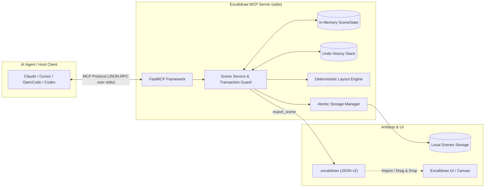

# Excalidraw MCP Server

> A high-performance, backend-only Model Context Protocol (MCP) server for programmatically generating, editing, and managing Excalidraw v2 diagrams.

[](https://www.python.org/)
[](https://github.com/jlowin/fastmcp)
[](https://modelcontextprotocol.io)
[](LICENSE)
[](https://hatch.pypa.io/)

---

## Overview

**Excalidraw MCP** empowers LLM agents (Claude, Cursor, OpenCode, Codex, and custom AI agents) to create, inspect, manipulate, and export rich [Excalidraw](https://excalidraw.com) diagrams directly from chat and automated workflows.

Built on [FastMCP](https://github.com/jlowin/fastmcp) using **Hatchling** as the build backend, it runs entirely local via standard I/O (`stdio`). It requires no browser, no headless Chromium, and no third-party cloud hosting, rendering deterministic, production-grade `.excalidraw` (schema v2) documents safely and atomically.

### Key Features

- **Semantic Diagramming**: Add rectangles, ellipses, diamonds, arrows, text, and bound labels with full Excalidraw styling (colors, stroke widths, fill styles, roughness, and opacity).
- **Intelligent Graph Layouts**: `draw_graph` automatically renders directed acyclic graphs and state diagrams using topological layered ranking, boundary-point docking, and collision-free dimension packing.
- **Dynamic Relationship Tracking**: Connectors automatically track shape boundaries when nodes are moved or resized.
- **Atomic Operations & In-Memory Undo**: Non-blocking transactions with process-local undo history (`undo`) and memory budgets.
- **Fail-Safe Local Persistence**: Atomic file writes (`fsync`), private POSIX permissions (`0600`/`0700`), and path-traversal guards.
- **Embedded Document Export**: Instant export to valid `.excalidraw` format for 1-click drag-and-drop into [excalidraw.com](https://excalidraw.com) or VS Code.
- **Automatic Agent Discovery**: Ships with a root `mcp.json` and `uvx` support for zero-config onboarding across modern AI coding environments.

---

## Architecture & Workflow



### Agent Workflow
1. **Creation**: Agent invokes `draw_graph`, `draw_architecture`, or primitive shape tools (`add_rectangle`, `add_circle`, `connect`).
2. **Inspection & Revision**: Agent verifies element placement using `get_scene` or `get_element`. If corrections are required, it calls `move`, `resize`, `update_element`, or `undo`.
3. **Persistence or Export**: The scene is saved locally with `save(name="arch-v1")` or exported directly to the conversation as an embedded file via `export_scene`.

---

## Quick Start

Run instantly without cloning the repository or managing virtual environments using [`uvx`](https://docs.astral.sh/uv/):

```bash
uvx --from git+https://github.com/Dharshan2208/excalidraw-mcp.git excalidraw-mcp
```

Or install it globally to your FastMCP environment:

```bash
fastmcp install mcp.json
```

---

## Client Configuration

Add `excalidraw-mcp` to your favorite MCP client configuration file:

### Claude Desktop
Add this to `claude_desktop_config.json`:
- **macOS**: `~/Library/Application Support/Claude/claude_desktop_config.json`
- **Windows**: `%APPDATA%\Claude\claude_desktop_config.json`
- **Linux**: `~/.config/Claude/claude_desktop_config.json`

```json
{
  "mcpServers": {
    "excalidraw": {
      "command": "uvx",
      "args": [
        "--from",
        "git+https://github.com/Dharshan2208/excalidraw-mcp.git",
        "excalidraw-mcp"
      ]
    }
  }
}
```

### Cursor
Add to `.cursor/mcp.json` in your project root or user configuration:

```json
{
  "mcpServers": {
    "excalidraw": {
      "command": "uvx",
      "args": [
        "--from",
        "git+https://github.com/Dharshan2208/excalidraw-mcp.git",
        "excalidraw-mcp"
      ]
    }
  }
}
```

### OpenCode
Add to `opencode.json` (or the MCP configuration section of your OpenCode settings):

```json
{
  "mcpServers": {
    "excalidraw": {
      "command": "uvx",
      "args": [
        "--from",
        "git+https://github.com/Dharshan2208/excalidraw-mcp.git",
        "excalidraw-mcp"
      ]
    }
  }
}
```

### Codex / Generic Agent Configuration
For CLI agents and runners accepting standard `mcpServers` JSON:

```json
{
  "mcpServers": {
    "excalidraw": {
      "command": "uvx",
      "args": [
        "--from",
        "git+https://github.com/Dharshan2208/excalidraw-mcp.git",
        "excalidraw-mcp"
      ],
      "env": {
        "EXCALIDRAW_HISTORY_LIMIT": "25"
      }
    }
  }
}
```

---

## Automatic Agent Discovery

This repository comes pre-packaged with a root [`mcp.json`](mcp.json) descriptor:

```json
{
  "mcpServers": {
    "excalidraw": {
      "command": "uvx",
      "args": [
        "--from",
        "git+https://github.com/Dharshan2208/excalidraw-mcp.git",
        "excalidraw-mcp"
      ]
    }
  }
}
```

When an MCP-compliant agent tool (e.g. `fastmcp list mcp.json`, Cursor, or Zed) scans your workspace, it will automatically detect the server and register all 24 tools with zero manual configuration.

---

## MCP Tools Reference

The server exports 24 typed tools designed with strict JSON schema bounds and explicit safety hints (`readOnly`, `destructive`, `idempotent`).

### 1. High-Level Generation

| Tool | Inputs | Outputs | Description |
|---|---|---|---|
| `draw_graph` | `nodes: list[GraphNode]`<br>`edges: list[GraphEdge]`<br>`clusters: list[GraphCluster] = None`<br>`layout: str = "layered"` (`layered`, `horizontal`, `vertical`)<br>`direction: str = "horizontal"` (`horizontal`, `vertical`)<br>`elbowed: bool = False`<br>`roundness: str | None = None` | `GraphResult`<br>`{ revision, element_count, node_map, edge_map, cluster_map }` | Replaces the scene with a structured diagram using automatic topological ranking, edge routing, clustered frame grouping, and label wrapping. Returns stable logical-to-element ID mappings. |
| `draw_architecture` | `prompt: str` (e.g., `"box: Frontend, db: Postgres"`)<br>Optional styles (`strokeColor`, `backgroundColor`, etc.) | `ArchitectureResult`<br>`{ revision, element_count, components }` | Rapid diagram generator parsing comma/newline-separated shorthand syntax (`box`, `circle`, `diamond`) with auto-connectors. |

### 2. Primitive Shapes, Text & Frames

| Tool | Inputs | Outputs | Description |
|---|---|---|---|
| `add_rectangle` | `x: float`, `y: float`, `w: float`, `h: float`<br>`label: str = ""` + styles + `roundness: str = None`, `frame_id: str = None` | `ElementResult`<br>`{ id, label_id, revision }` | Adds a rectangle to the active scene with an optional centered bound label, adaptive/round corner roundness, and frame membership. |
| `add_circle` | `x: float`, `y: float`, `size: float`<br>`label: str = ""` + styles + `frame_id: str = None` | `ElementResult`<br>`{ id, label_id, revision }` | Adds a circle (ellipse) with an optional centered bound label and frame membership. |
| `add_diamond` | `x: float`, `y: float`, `w: float`, `h: float`<br>`label: str = ""` + styles + `roundness: str = None`, `frame_id: str = None` | `ElementResult`<br>`{ id, label_id, revision }` | Adds a decision diamond with an optional centered bound label, adaptive roundness, and frame membership. |
| `add_arrow` | `x: float`, `y: float`, `x2: float`, `y2: float`<br>`label: str = ""` + styles + `elbowed: bool = False` | `ElementResult`<br>`{ id, label_id, revision }` | Adds a directional arrow (straight or elbowed) with an optional midpoint label. |
| `add_text` | `x: float`, `y: float`, `content: str`<br>`font_size: int = 20` + styles + `frame_id: str = None` | `CreateResult`<br>`{ id, revision }` | Creates a standalone text element with optional frame membership. |
| `connect` | `source_id: str`, `target_id: str`<br>`label: str = ""` + styles + `elbowed: bool = False` | `ConnectResult`<br>`{ arrow_id, label_id, revision }` | Binds two existing shapes with a self-docking straight or elbowed arrow that tracks shape movement. |
| `add_frame` | `name: str = ""`, `x: float`, `y: float`, `w: float`, `h: float`<br>`element_ids: list[str] = None` | `CreateResult`<br>`{ id, revision }` | Creates an Excalidraw frame container and optionally parents specified elements inside it. |

### 3. Scene Editing & Manipulation

| Tool | Inputs | Outputs | Description |
|---|---|---|---|
| `move` | `element_id: str`, `x: float`, `y: float` | `MoveResult`<br>`{ element_id, x, y, revision }` | Repositions an element. Moving a frame moves all contained elements; bound labels and attached connectors follow automatically. |
| `resize` | `element_id: str`, `width: float`, `height: float` | `ResizeResult`<br>`{ element_id, width, height, revision }` | Resizes a shape or frame, recalculates label centering, and reroutes connected arrows. |
| `update_element` | `element_id: str`<br>`label: str | None = None` + styles + `roundness`, `elbowed`, `frame_id` | `UpdateResult`<br>`{ element_id, label_id, revision }` | Modifies an element's label, styling, roundness mode, elbowed connector routing, or frame assignment. |
| `delete` | `element_id: str` | `DeleteResult`<br>`{ deleted_id, deleted_label_id, revision }` | Deletes an element and its bound label; unparents frame children if a frame is deleted; cleans up references in connected arrows. |
| `batch_mutate` | `operations: list[dict]` | `BatchResult`<br>`{ status, operations_executed, ref_map, results, revision }` | Atomically executes multiple creation, connection, movement, resize, or update actions in a single revision step with dynamic `client_id` resolution. |
| `clear` | None | `DeleteResult`<br>`{ deleted: true, revision }` | Wipes the entire scene, active elements, and embedded state. |
| `undo` | None | `UndoResult`<br>`{ restored_revision, available_history }` | Rolls back the scene to the state immediately preceding the latest mutation. |

### 4. Inspection, Query, Export & Storage

| Tool | Inputs | Outputs | Description |
|---|---|---|---|
| `find_elements` | `query: str | None`<br>`type: str | None`<br>`frame_id: str | None`<br>`element_id: str | None`<br>`connected_to: str | None`<br>`include_bound_labels: bool = False`<br>`limit: int = 50` | `FindResult`<br>`{ matches, total, revision }` | Filters active elements by text search, element type, parent frame, ID, or graph connectivity. |
| `get_scene` | `offset: int = 0`, `limit: int = 50` | `ScenePage`<br>`{ elements, total, offset, limit, has_more, revision }` | Paginated inspection of all elements currently on the canvas. |
| `get_element` | `element_id: str` | `ElementResult`<br>`{ element, revision }` | Fetches details and properties of a single element by its ID. |
| `list_saved_scenes`| None | `SavedScenesResult`<br>`{ scenes: list[str] }` | Returns a list of all scene files stored in the persistent directory. |
| `save` | `name: str`, `overwrite: bool = False` | `SaveResult`<br>`{ name, revision, path }` | Atomically writes the scene to server disk in `.excalidraw` JSON format. |
| `load` | `name: str` | `LoadResult`<br>`{ name, revision, element_count }` | Atomically loads a saved `.excalidraw` file and sets it as the active scene. |
| `export_scene` | None | `EmbeddedResource`<br>(`application/vnd.excalidraw+json`) | Emits the entire `.excalidraw` schema v2 document directly into the MCP message. |
| `preview` | `scale: float = 1.0`<br>`padding: int = 40` | `ImageContent`<br>(`image/png`) | Renders an inline PNG image preview of the active Excalidraw canvas directly into the chat conversation. |

---

## MCP Resources

In addition to tools, the server exposes saved scenes via standard MCP resource URIs:
- **URI Template**: `excalidraw://scenes/{name}.excalidraw`
- **MIME Type**: `application/vnd.excalidraw+json`

Clients can directly read saved scenes into their context window without altering the active working canvas.

---

## Environment Variables & Configuration

The server operates with secure defaults and zero required environment variables. Fine-tune performance and resource limits via the environment:

| Variable | Default | Allowed Values | Description |
|---|---|---|---|
| `EXCALIDRAW_SCENE_DIR` | Platform User Data | Absolute path | Directory where scenes are persisted. Defaults to `$XDG_DATA_HOME/excalidraw-mcp/scenes` on Linux, and `~/Library/Application Support/excalidraw-mcp/scenes` on macOS. |
| `EXCALIDRAW_HISTORY_LIMIT` | `20` | `1`–`100` | Maximum number of in-memory undo snapshots retained per session. |
| `EXCALIDRAW_MAX_HISTORY_BYTES` | `104857600` (100 MiB) | 1 KiB–500 MiB | Shared memory ceiling allocated for serialized undo states. |
| `EXCALIDRAW_MAX_SCENE_BYTES` | `26214400` (25 MiB) | 1 KiB–100 MiB | Maximum file size permitted when saving or loading scene files. |
| `EXCALIDRAW_MAX_EXPORT_BYTES` | `26214400` (25 MiB) | 1 KiB–100 MiB | Maximum payload size permitted for `export_scene` and resource reads. |
| `EXCALIDRAW_MAX_ELEMENTS` | `10000` | `1`–`100,000` | Hard cap on the total number of elements allowed per scene. |

---

## Local Development & Debugging

### Prerequisites
- Python `>= 3.12`
- [`uv`](https://docs.astral.sh/uv/) (recommended) or `pip`

### 1. Clone & Set Up Environment

```bash
git clone https://github.com/Dharshan2208/excalidraw-mcp.git
cd excalidraw-mcp

# Synchronize dependencies with uv
uv sync

# Or with pip & virtualenv
python3 -m venv .venv
source .venv/bin/activate
pip install -e .
```

### 2. Run the Test Suite

The test suite contains 143 unit and contract tests verifying Excalidraw serialization, layout mathematics, boundary snapping, storage safety, and MCP schemas:

```bash
uv run python -B -m unittest discover -s tests -v
```

### 3. Interactive Debugging with FastMCP Inspector

Inspect schemas, invoke tools interactively, and test stdio communications using the built-in FastMCP web inspector:

```bash
uv run fastmcp inspect mcp.json
```

Or list discovered tools:

```bash
uv run fastmcp list mcp.json
```

### 4. Packaging Verification

Test source distribution and wheel generation with Hatchling:

```bash
uv build
```

---

## Contributing

Contributions are warmly welcomed! Please follow these guidelines:

1. **Fork the Repository**: Create a descriptive feature branch (`git checkout -b feat/custom-styling`).
2. **Adhere to Code Standards**: Ensure clean type annotations, preserve existing docstrings, and maintain standard exception hierarchies.
3. **Verify Tests**: Run `uv run python -B -m unittest discover -s tests -v` and ensure all tests pass.
4. **Compile Check**: Confirm no byte-compilation warnings via:
   ```bash
   uv run python -B -m compileall -q -f main.py excalidraw_mcp tests
   ```
5. **Submit a Pull Request**: Provide a concise summary of the rationale and changes.

---

## Standards & License

- **Protocol Specification**: Complies with the official [Model Context Protocol Specification](https://modelcontextprotocol.io).
- **Document Format**: Serializes to standard [Excalidraw schema v2](https://github.com/excalidraw/excalidraw).
- **License**: Released under the [MIT License](LICENSE).
